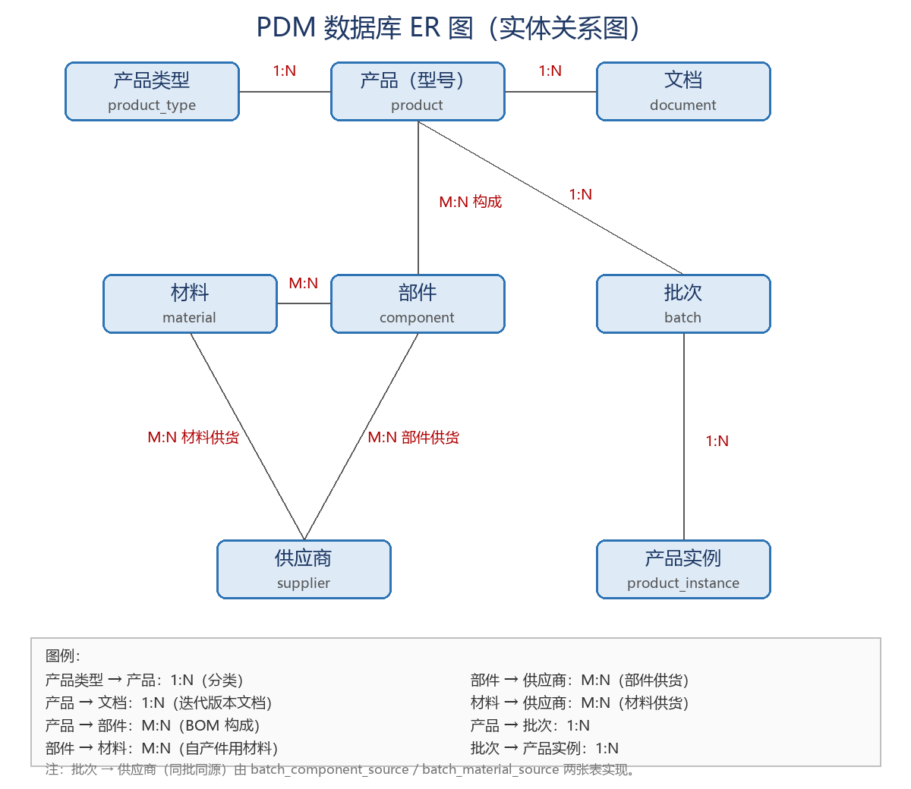

# PDM 产品数据管理系统（数据库设计）

课程作业 **C1 产品数据管理（PDM）数字化系统** 的数据库模式设计。

## 项目简介

PDM（Product Data Management）用于管理产品相关信息（零件、配置、文档、CAD 文件、结构、权限等）和产品相关过程。本项目实现一个简化的 PDM 数据库，覆盖：

- 产品类型 / 系列 / 型号规格 / 价格
- **产品迭代版本**及其设计说明书、设计图、CAD 文件
- 产品由多个部件构成（BOM），同一部件可用于不同产品
- 部件来源：采购件 / 采购材料自产件；自产部件由多种材料构成
- 部件、材料与供应商的多对多供货关系
- 同一批产品共享供货源（批次级锁定），每个产品有唯一出厂序列号
- 按出厂序列号追溯部件与材料的实际供应商，用于探究缺陷原因
- 简化的角色 / 用户 / 文档权限

## 目录结构

```
pdm-database/
├── README.md                         本文件
├── schema.sql                        一体化脚本：建表 + 示例数据 + 查询
├── er_diagram.png                    v1 ER 图（保留作对照）
├── docs/
│   ├── 01_需求分析与设计说明.md      题目 1-9 映射、设计决策、范式说明
│   ├── 02_数据字典.md                18 张表逐字段说明
│   ├── 03_ER图_v2.md                 当前版本 ER 图（mermaid，GitHub 直接渲染）
│   ├── 04_改动与学习指引.md          v1→v2 改动清单、自验步骤、答辩要点
│   └── 05_小白从零实验教程.md        面向初学者的完整通关教程（读题→设计→运行→交作业）
└── tests/
    └── validate_seed_data.py         示例数据自洽性校验（不需要 MySQL）
```

> **ER 图以 `docs/03_ER图_v2.md` 为准**；根目录 PNG 是 v1 版本，留着对比看演进。

## 数据库表（18 张，分 5 组）

| 组 | 表 |
| --- | --- |
| 产品与文档 | `product_type`、`product`、`product_version`、`document` |
| 部件与 BOM | `component`、`material`、`product_component`、`component_material` |
| 供应商 | `supplier`、`component_supplier`、`material_supplier` |
| 批次与追溯 | `batch`、`product_instance`、`batch_component_source`、`batch_material_source` |
| 权限（扩展） | `sys_role`、`sys_user`、`doc_permission` |

其中 `batch_component_source` / `batch_material_source` 是本题核心：**可供清单**记录「谁能供什么」，**批次供货源**记录「这一批实际用了谁家的」，后者用 `PRIMARY KEY(batch_id, 物料id)` 保证同一批次每种物料只有一家供应商。

## 如何运行

环境：MySQL 8.0.16+（`CHECK` 约束需要这个版本以上）；Python 3.x 仅用于自检脚本，无第三方依赖。

> **第一次做数据库设计题？** 先读 [小白从零实验教程](docs/05_小白从零实验教程.md)，它从「怎么读题」讲起，包含 MySQL Workbench 每一步点哪儿、每段 SQL 为什么这么写、跑出来应该看到什么。

1. 可选，先自检示例数据（不需要连数据库）：

   ```bash
   python tests/validate_seed_data.py
   ```

   全部 `[OK]` 且最后 `[PASS]` 才说明 INSERT 数据自洽，尤其是批次供货表的复合外键。

2. 打开 MySQL Workbench，新建查询，整体执行 `schema.sql`。脚本开头会 `DROP` 旧表，可反复运行。
3. 执行完脚本末尾的查询，查看各组结果（查询 1、2-A/2-B/2-C、3-①/②/③、权限查询）。

## 三类查询（对应题目第 9 条）

| 查询 | 内容 | 统计方式 |
| --- | --- | --- |
| 查询 1 | 某产品的设计文档 | `product → product_version → document`，按版本与文档类型组织 |
| 查询 2-A | 供应商供货统计 | 按供应商：可供部件 / 材料种类数 |
| 查询 2-B | 供应商供货统计 | 按物料：每种物料有几家可选供应商 |
| 查询 2-C | 供应商供货统计 | 按批次：各批次里每家供应商实际供了多少种物料 |
| 查询 3-①/② | 缺陷溯源 | 部件层 / 材料层分别展开 |
| 查询 3-③ | 缺陷溯源 | `UNION ALL` 合并两层，一次看全 |

链路：`serial_no → batch_id → batch_*_source → supplier`，物料清单由 `product_component` 与 `component_material` 两层 BOM 展开得到。

## 动手验证

- 把查询 3-③ 里的 `'SN0001'` 改成 `'SN0003'` 再跑：同一个型号 X100，因分属不同批次，外壳 / 显示屏 / 接头 / 芯片的供应商会变 —— 这就是缺陷定位的数据依据。
- `schema.sql` 末尾有 3 条注释掉的违规 INSERT，解开执行应分别报主键重复、复合外键失败、CHECK 失败，可截图放进报告。

## 设计文档

- [需求分析与设计说明](docs/01_需求分析与设计说明.md) — 题目逐条映射、5 个设计决策、完整性约束、3NF
- [数据字典](docs/02_数据字典.md)
- [ER 图 v2](docs/03_ER图_v2.md)
- [改动与学习指引](docs/04_改动与学习指引.md) — 含自验步骤与答辩要点
- [小白从零实验教程](docs/05_小白从零实验教程.md) — **初学者从这里开始**：读题翻译、设计推导、软件点击步骤、SQL 逐段讲解、预期结果、排错、练习路径

## ER 图


