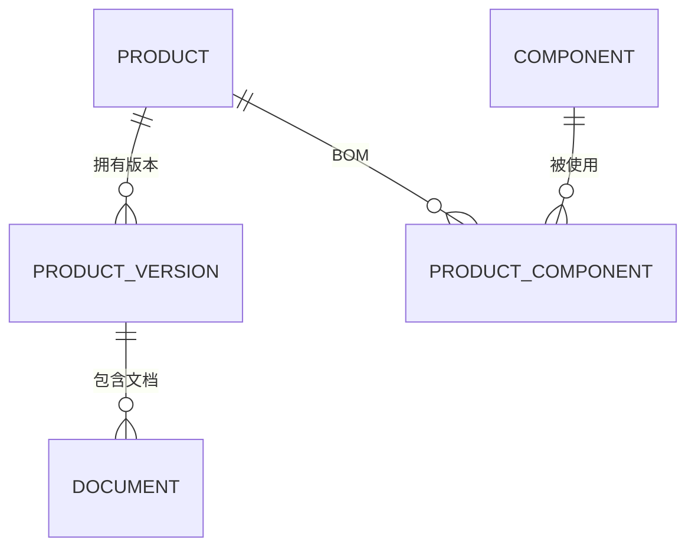

# C1 PDM 数据库实验 · 小白从零通关教程

> **写给谁**：上学期只学过一点数据库基础（大概会写 `CREATE TABLE`、简单 `SELECT`），看到这道 9 条业务描述的题目完全不知道从哪下手的同学。
> **学完能做到**：自己看懂题目 → 想出该建哪些表 → 知道每行 SQL 为什么这么写 → 在电脑上真的跑起来 → 知道结果对不对 → 会交作业。
> **配套代码**：本仓库根目录的 `schema.sql`（v2 版，18 张表，一份文件包含建表 + 数据 + 查询）。教程里所有代码都从这份文件里摘出来，**不会和你仓库里的文件对不上**。
> **不用怕**：数据库设计不是靠聪明，是靠一套固定的"翻译动作"。这篇教程教的就是这套动作。

---

## 0. 先搞清楚：老师到底要你交什么

### 0.1 这道题的本质

题目名字叫「设计简化的 PDM 数据库模式」，翻译成人话就是：

> 给你一段描述公司业务的文字，请你把它变成**一堆表 + 表之间的关系**，再写几条查询证明这堆表真的能回答业务问题。

注意关键词是**「模式」（schema）**，不是「做个系统」。所以：

- ✅ 要交的是：`CREATE TABLE` 建表语句、示例数据、`SELECT` 查询、ER 图、设计说明文档。
- ❌ 不需要：网页、App、登录界面、Java/Python 程序。之前有别的 AI 给你写过应用代码，那不是本题的重点，可以先放一边。

老师打分看三件事：
1. **题目 1–8 条有没有都落到表里**（漏一条扣一条）；
2. **关系画得对不对**（尤其是多对多、批次、序列号）；
3. **第 9 条的三类查询能不能跑出有意义的结果**（空结果 = 没分）。

### 0.2 最终仓库里该有什么

打开你的仓库 `D:\GitHub\pdm-database`，现在长这样：

```
pdm-database/
├── README.md                          门面：老师第一眼看
├── schema.sql                         ★ 主交付：建表 + 示例数据 + 查询（一份跑通）
├── er_diagram.png                     v1 的 ER 图（留作对照）
├── docs/
│   ├── 01_需求分析与设计说明.md        题目 1-9 → 表的映射、设计决策
│   ├── 02_数据字典.md                  18 张表逐字段说明
│   ├── 03_ER图_v2.md                   当前 ER 图（mermaid，GitHub 直接显示）
│   ├── 04_改动与学习指引.md             v1→v2 改了什么、答辩 3 问
│   └── 05_小白从零实验教程.md           ← 本文件
└── tests/
    └── validate_seed_data.py          不连数据库也能查数据对不对的脚本
```

### 0.3 需要准备的软件

| 软件 | 用来干嘛 | 必须吗 |
| --- | --- | --- |
| **MySQL 8.0.16 以上** | 真正执行 SQL 的数据库 | 交作业建议有 |
| **MySQL Workbench** | 图形界面，点按钮就能执行 SQL，小白友好 | 强烈建议 |
| **Python 3.x** | 跑 `tests/validate_seed_data.py` 自检（无任何第三方库） | 可选 |
| **GitHub Desktop** | 提交 / 推送代码 | 你已经在用了 |
| 一个文本编辑器（VS Code / 记事本都行） | 看 SQL 文件 | 可选 |

> 为什么强调 **8.0.16+**：脚本里用了 `CHECK` 约束，MySQL 在 8.0.16 之前会"看见但忽略"它，等于没写。低版本跑不会报错，但约束不生效，白做。

### 0.4 全程路线图（9 步）

```
① 读题翻译人话 → ② 设计：名词变表 → ③ 装环境打开软件
→ ④ 建表 DDL → ⑤ 插示例数据 → ⑥ 跑 8 组查询
→ ⑦ 验证约束与排错 → ⑧ 写文档画图 → ⑨ Git 提交推送
```

**最关键的是第 ② 步**。代码谁都能抄，但"为什么是这 18 张表"才是这门课考的东西。所以第 1、2 步请拿张纸跟着画，别跳过。

### 0.5 本教程的记号

后面每个操作都用这四种标记，照着做就行：

- **【打开】** 该打开哪个软件 / 哪个窗口 / 哪个菜单
- **【输入】** 在哪个框里粘贴或敲什么
- **【执行】** 点哪个按钮或按什么快捷键
- **【看到】** 跑对了应该出现什么（**这一步最重要，用来判断自己有没有做错**）

---

## 1. 第 1 步：把题目翻译成人话（先别碰电脑）

拿张纸，把题目 9 条抄下来，逐条用大白话重写一遍。这不是浪费时间，是在帮你**圈名词**。

| 题号 | 题目原文（浓缩） | 人话 | 这句话在暗示什么 |
| --- | --- | --- | --- |
| 1 | 多种类型产品，同类有系列、型号规格、价格 | 公司卖手机、无人机、扫地机；手机里有 X 系列，X100 卖 4999 | 要有「产品类型」和「产品型号」两个层次 |
| 2 | 每种产品保存**迭代版本**的设计说明书、设计图 | X100 出过 v1.0、v1.1，每次改版都有一套文档 | 「版本」是个独立的东西，不能只当成一个字段 |
| 3 | 产品由多个部件构成 | 一台 X100 = 外壳 + 屏幕 + 处理器 + 电池 + 主板 + 接线 | 产品和部件是「一对多」？不对，看第 4 条 |
| 4 | 同一个部件可能用于不同产品 | 外壳既能装 X100，也能装无人机 | 所以是**多对多**，必须加中间表 |
| 5 | 部件来源：买现成的 / 买材料自己做 | 外壳是买的；主板是我们买 PCB 和芯片自己焊的 | 部件要有个「来源」标记 |
| 6 | 自产部件可能用多种材料 | 接线 = 接头 ×2 + 连接线 ×1 | 部件和材料又是**多对多**，又一张中间表 |
| 7 | 每种部件/材料可从多家采购；一家供应商卖多种 | 外壳可以从深圳买也可以从东莞买；立讯既卖外壳也卖接头 | 供应商和物料也是**多对多**，而且是**两个方向** |
| 8 | 同一批产品供货源相同；每台有唯一出厂序列号 | 3 月 1 日生产的那 100 台 X100，外壳全用深圳那家；每台机器有个 SN 码 | 「批次」必须单独建表；SN 挂在**单台机器**上，不是型号上 |
| 9 | 要查：设计文档 / 供应商供货统计（不同统计方式）/ 按序列号查供应商找缺陷原因 | 最后得能用 SQL 回答这三个问题 | **倒推**：如果查不出来，说明前面表设计漏了 |

### 1.1 圈名词（这些基本就是你的表）

把上面表格里所有"东西"圈出来：

> 产品类型、产品型号、**产品版本**、设计文档、部件、材料、供应商、**生产批次**、**单台产品（序列号）**、角色、用户、文档权限

### 1.2 圈动词 / 关系（这些基本就是你的中间表或外键）

> 产品 **由…构成** 部件、自产部件 **由…组成** 材料、供应商 **可供** 部件/材料、某批次 **实际用了** 某供应商、单台产品 **属于** 某批次、版本 **拥有** 文档

### 1.3 三个最容易翻车的词（先记住，第 2 步会解释）

| 词 | 小白最容易误解成 | 正确理解 |
| --- | --- | --- |
| **迭代版本** | 文档自己的版本号（R1、R2） | 产品的一次改版（v1.0 → v1.1），一次改版下面挂多份文档 |
| **批次** | 一个普通编号字段 | 一整批货共用同一份供货记录，是**溯源的锚点** |
| **出厂序列号** | 产品型号的属性 | 一台具体机器的身份证，型号是设计图纸，序列号是实体机器 |

---

## 2. 第 2 步：设计 —— 从名词到表（本作业最值钱的一步）

### 2.1 一条万能翻译公式

> **① 名词 → 一张表**
> **② 两个名词之间如果是「多对多」→ 额外加一张中间表**
> **③ 「一对一 / 一对多」→ 在"多"的那张表里加一个外键字段**
> **④ 每种东西都要有主键（身份证号）**
> **⑤ 题目里说"唯一""不能重复" → 加 UNIQUE**
> **⑥ 最后拿第 9 条的查询反推：查得出来吗？查不出来就补表**

就这 6 条，所有数据库设计题都是这么啃的。下面带你走一遍。

### 2.2 第一轮：名词直接变表（8 张）

先别管关系，把圈出来的名词各建一张表，每张给个主键：

| 表 | 主键 | 关键字段（先想大概） |
| --- | --- | --- |
| `product_type` 产品类型 | `type_id` | `type_name`（手机/无人机/扫地机） |
| `product` 产品型号 | `product_id` | `type_id`、`series` 系列、`model` 型号、`price` 价格 |
| `product_version` 产品版本 | `version_id` | `product_id`、`version_no`（v1.0）、`release_date`、`change_note` |
| `document` 设计文档 | `doc_id` | `version_id`、`doc_type`、`title`、`file_path` |
| `component` 部件 | `component_id` | `component_name`、`source_type`（采购/自产） |
| `material` 材料 | `material_id` | `material_name` |
| `supplier` 供应商 | `supplier_id` | `supplier_name`、`contact`、`phone` |
| `sys_role` / `sys_user` / `doc_permission` | — | 权限扩展（题目总述提到"权限信息"，加分项，不影响 1–9 条） |

**为什么要 `product_type` 和 `product` 两张？** 因为题目说"多种类型产品，**同类**产品会有不同系列型号"。类型（手机）和型号（X100）是 1:N：一个类型下有多个型号。如果你把 `type_name` 直接写在 `product` 里，也能跑，但"手机"两个字会重复很多遍，改个名字要改一堆行 —— 这就叫**冗余**，第 2.9 节会讲。

**为什么 `product_version` 要单独一张？** 这是 v1 版本被扣分的地方。如果只在 `document` 里放个 `version` 字段，那么 v1.1 这次改版下的「说明书 + 设计图 + CAD 文件」三份文档之间没有任何关联，也记不下"这次改版改了散热"这种说明。提成表之后：`product → product_version → document` 三层，一次改版下的文档自然归组。

### 2.3 第二轮：多对多必须加中间表（重点！）

**这是小白最卡的地方，慢慢看。**

题目第 3、4 条合起来是："一个产品有多个部件，**且一个部件能用在多个产品上**"。

假设你偷懒，在 `component` 表里加一个 `product_id` 字段，会怎样？

```
component 表（错误示范）
component_id | component_name | product_id
1            | 外壳            | 1
2            | 外壳            | 2      ← 同一个外壳，为了给两个产品用，得存两遍
3            | 外壳            | 3      ← 三遍……
```

外壳的价格、来源、供应商全被复制三份，改一次要改三行，还容易出现"两个外壳信息不一致"。所以**不能这么干**。

正确做法是：部件只存一份，另外拿一张表专门记"谁和谁搭上了"：

```
product_component（中间表）
product_id | component_id | quantity
1          | 1            | 1     ← X100 用 1 个外壳
2          | 1            | 1     ← X200 Pro 也用这个外壳
3          | 1            | 1     ← AirMini 也用
```

这张表一行就是"一个配对"。`PRIMARY KEY (product_id, component_id)` 保证同一个配对不会记两次；`quantity` 是**这个关系自己的属性**（用量），所以放在中间表里，不能放部件表。

> **记住这个模式**：只要看到「A 有多个 B，B 也属于多个 A」，就建第三张表，里面只放两个 id + 关系本身的属性。这门课里叫 **M:N 联系转换为关系模式**。

按这条规则，本作业一共需要 4 张这样的中间表：

| 中间表 | 连接的两头 | 关系自带的属性 | 对应题目 |
| --- | --- | --- | --- |
| `product_component` | 产品 ↔ 部件 | `quantity` 用量 | 3、4 |
| `component_material` | 自产部件 ↔ 材料 | `quantity` 用量（接线=接头×2+连接线×1） | 6 |
| `component_supplier` | 部件 ↔ 供应商 | `supply_price` 报价 | 7 |
| `material_supplier` | 材料 ↔ 供应商 | `supply_price` 报价 | 7 |

### 2.4 第三轮：第 8 条逼出来的 4 张表（本题核心）

现在到了最容易漏的地方。请重读第 8 条和第 9 条：

> 「同一批产品用的部件和材料供货源相同；每个产品都有这个唯一的出厂序列号」
> 「某个产品的部件材料的供应商，以探究产品缺陷产生的原因」

用第 ⑥ 条公式**倒推**：假如客户拿来一台坏掉的手机，报出序列号 `SN0001`，你要回答"这台机器的外壳是谁家供的"。你的表里能查到吗？

- 查 `component_supplier`（可供清单）→ 只能得到「外壳**可能**来自深圳或东莞」，**不知道这台到底用了哪家的**。❌
- 所以必须再记一层：**这一批实际用了谁家的**。

于是要加：

| 表 | 作用 | 关键设计 |
| --- | --- | --- |
| `batch` 生产批次 | 记录 B20260301 这一批生产的是 X100 | `batch_no` 唯一 |
| `product_instance` 单台产品 | 记录每台出厂机器 | `serial_no` 作主键，带 `batch_id` 外键 |
| `batch_component_source` | 某批次的某部件 → 实际供应商 | `PRIMARY KEY(batch_id, component_id)` |
| `batch_material_source` | 某批次的某材料 → 实际供应商 | `PRIMARY KEY(batch_id, material_id)` |

**那个联合主键就是题目第 8 条的实现**：`batch_id + 物料id` 只能出现一行，所以同一批次里外壳不可能同时登记两家供应商。而每一台机器通过自己的 `batch_id` "继承"整批的供货记录，不用给 100 台机器各存一遍。

于是形成整道题的灵魂链路：

```
serial_no → batch_id → batch_*_source → supplier_id → supplier_name
  (哪台机器)   (哪一批)     (这批用了谁)      (供应商编号)   (名字)
```

**这里要分清两个词，答辩必问**：

| | 可供清单 `component_supplier` | 批次供货源 `batch_component_source` |
| --- | --- | --- |
| 回答的问题 | 「谁**能**供这个件？」 | 「这一批**实际**用了谁家的？」 |
| 性质 | 长期能力，多对多 | 一次生产的事实，批次内唯一 |
| 少了它会怎样 | 不知道可以找谁采购 | **缺陷溯源直接查不出来** |

### 2.5 汇总：18 张表，分 5 组

| 组 | 表 | 管题目第几条 |
| --- | --- | --- |
| 产品与文档 | `product_type`、`product`、`product_version`、`document` | 1、2 |
| 部件与 BOM | `component`、`material`、`product_component`、`component_material` | 3、4、5、6 |
| 供应商 | `supplier`、`component_supplier`、`material_supplier` | 7 |
| 批次与追溯 | `batch`、`product_instance`、`batch_component_source`、`batch_material_source` | 8、9 |
| 权限（扩展） | `sys_role`、`sys_user`、`doc_permission` | 总述 |

> 术语 **BOM**（Bill of Materials，物料清单）：就是"一个产品由哪些东西组成、各用几个"。本作业是**两层 BOM**：产品→部件（第一层），自产部件→材料（第二层）。

### 2.6 画 ER 图

ER 图就是"把上面 5 组画成方框，用线连起来，线上标 1 或 N"。

**画法**：
1. 每个实体画矩形，写表名，框里列主键（PK）和主要字段；
2. 中间表画成菱形或小矩形（本作业直接画成表更好懂）；
3. 连线上标基数：`product ──1 : N── product_version`，`product ──M : N(经 product_component)── component`；
4. 图例写明 PK / FK / 1:N / M:N。

**最省事的做法**：用 mermaid 写，GitHub 会自动渲染成图，不用画图软件。打开 `docs/03_ER图_v2.md` 就是现成例子，语法长这样：



`||` 是"恰好一个"，`o{` 是"零到多个"，`||--o{` 整体读作"一对多"。

### 2.7 逐条打勾（设计完一定要做）

| 题号 | 检查点 | 本方案 |
| --- | --- | --- |
| 1 | 类型 / 系列 / 型号 / 价格都有字段 | ✅ `product_type` + `product` |
| 2 | 文档挂在**版本**上 | ✅ `product_version` + `document.version_id` |
| 3/4 | 产品↔部件 M:N 且带用量 | ✅ `product_component` |
| 5/6 | 采购/自产标志 + 第二层 M:N | ✅ `source_type` + `component_material` |
| 7 | 供应商↔物料 M:N，示例数据两个方向都有 | ✅ 两张可供清单 |
| 8 | 批次表、单品表、SN 唯一、批次供货表 | ✅ 4 张表 |
| 9 | 三类查询都能跑出非空结果 | ✅ 见第 6 步 |

### 2.8 五个设计决策（答辩时照着说）

1. **为什么版本单独建表** → 题目说的是产品迭代版本，不是文档修订号；一次改版下有多份文档，还要记改版说明和发布日期。
2. **为什么必须有两张批次供货表** → 可供清单只说明"能供"，缺陷溯源要的是"实际用了谁家"，两者不能互相替代。
3. **为什么部件和材料分两张表** → 语义不同：部件参与产品 BOM 且有"采购/自产"属性，材料只参与自制件构成。代价是中间表变多。**如果重新设计，可以合并成一张统一物料表（加 `item_type` 字段），统计 SQL 会简单很多** —— 承认这是取舍，比硬说"只能这样"更加分。
4. **为什么 SN 挂在 `product_instance`** → `product` 是型号（图纸），一个型号能生产上万台；SN 是单台机器的身份证。
5. **权限为什么这么简单** → 按"角色 + 文档类型"控制读写，不细化到单份文档，是题目总述的简化呼应，删掉也不影响 1–9 条。

### 2.9 什么叫 3NF（用本作业的例子说）

老师常问"你的模式满足第几范式"。不用背定义，记住三句人话：

- **1NF**：每个格子只放一个值，不能塞"外壳,显示屏,电池"这种列表 → 我们把它们拆成 `product_component` 的多行。
- **2NF**：非主键字段必须依赖**整个**主键 → `product_component` 主键是 `(product_id, component_id)`，`quantity` 描述的是"这个产品用这个部件几个"，依赖两个 id 一起，没毛病；如果把 `component_name` 也塞进来，它只依赖 `component_id`（半个主键），就违规了。
- **3NF**：非主键字段不能依赖另一个非主键字段 → 比如 `product` 表里别存 `type_name`，因为它依赖的是 `type_id`（另一个非主键字段），应该通过外键去 `product_type` 查。

一句话总结：**「每个事实只在一个地方存一份」**，本方案满足 3NF。

---

## 3. 第 3 步：装环境、打开软件（手把手点哪儿）

### 3.1 方案 A（推荐）：MySQL + Workbench 图形界面

**【打开】** 浏览器 → 搜 "MySQL Community Server download" → 下载 MySQL Installer for Windows（选 `mysql-installer-community`，约 400MB）。

**【输入】** 安装时注意这几个界面：

| 安装界面 | 怎么选 |
| --- | --- |
| Choosing a Setup Type | 选 **Developer Default**（会同时装上 Workbench） |
| Check Requirements | 缺 VC++ 运行库就让它自动装，或点 Execute |
| Type and Networking | **Port 保持 3306**，记牢这个数字 |
| Authentication Method | 选 **Use Strong Password Encryption**（默认） |
| Accounts and Roles | **设置 root 密码，写在纸上！** 例如 `Pdm123456` |
| Windows Service | 勾 "Start the MySQL Server at System Startup" |

装完开始菜单里会有 **MySQL Workbench 8.0 CE**。

> 只想快速验证、不想装 400MB？可以装 **XAMPP**（自带 MySQL + phpMyAdmin），或者用在线的 db-fiddle.com（选 MySQL 8）。但 `CREATE DATABASE ... CHARACTER SET utf8mb4` 这类语句在在线版可能被限制，交作业还是建议本机装。

### 3.2 第一次打开 Workbench，新建连接

**【打开】** MySQL Workbench。首页是 "MySQL Connections"，点那个 **⊕（加号）**。

**【输入】** 弹出 "Setup New Connection"，逐项填：

```
Connection Name : PDM本地          ← 随便起，自己认得就行
Connection Method: Standard (TCP/IP)
Hostname        : 127.0.0.1       ← 本机，也可写 localhost
Port            : 3306
Username        : root
Password        : 点 "Store in Vault..." 输入你安装时设的密码
Default Schema  : 留空（等脚本自己建库）
```

点 **Test Connection** → 出现 "Successfully made the MySQL connection" 就对了 → **OK**。

> 如果报 `Can't connect to MySQL server on '127.0.0.1'`：说明服务没启动。按 `Win + R` 输入 `services.msc`，找到 **MySQL80**，右键 → 启动。

**【打开】** 双击首页上刚建的那个 `PDM本地` 方块，进入主界面。左边是 **SCHEMAS**（数据库列表），中间是 **Query 编辑器**，下面是 **Output / Result Grid**。

### 3.3 方案 B：命令行（如果你更习惯敲命令）

**【打开】** 开始菜单 → **MySQL 8.0 Command Line Client**，输入 root 密码。

**【输入】** `D:\GitHub\pdm-database` 目录下的脚本：

```bash
mysql -u root -p < "D:\GitHub\pdm-database\schema.sql"
```

或者在 mysql 提示符里：

```sql
source D:/GitHub/pdm-database/schema.sql
```

> 注意路径用**正斜杠** `/`，Windows 的反斜杠在 `source` 里容易被当转义符。

### 3.4 方案 C：暂时没装 MySQL 也能做的事

1. 打开 `schema.sql` 通读一遍（本教程第 4–6 步就是在带你读）；
2. 跑自检脚本，先确认示例数据没写错：

   **【打开】** `Win + R` → 输入 `cmd` → 回车
   **【输入】**
   ```bash
   cd /d D:\GitHub\pdm-database
   python tests\validate_seed_data.py
   ```
   **【看到】**
   ```
   [OK] 主键检查: 18 张表 / 122 行
   [OK] 外键检查: 112 处引用
   [OK] 复合外键: 15 条部件供货源 + 14 条材料供货源
   [OK] 批次一致性: 6 个出厂序列号
   [OK] 溯源完整性: 4 个批次 / 36 项物料均有实际供货源

   [PASS] 示例数据自洽，可以导入 MySQL。
   ```
   最后一行是 `[PASS]` 才算过。这个脚本**不连数据库**，它直接读 SQL 文本里的 INSERT 来做检查，所以在没装 MySQL 的电脑上也能跑。

### 3.5 检查版本（很重要）

**【输入】** 在 Workbench 的查询标签里敲：

```sql
SELECT VERSION();
```

**【执行】** 点工具栏的 **⚡ 闪电图标**（或 `Ctrl + Enter`）。

**【看到】** 下方 Result Grid 里出现一行，比如 `8.0.36`。
- 如果 `< 8.0.16`：脚本照样能跑，但 `CHECK` 约束**不会生效**，第 7 步的约束验证会失败。建议升级。
- 如果中文全变成 `???`：检查建库语句里有没有 `CHARACTER SET utf8mb4`（脚本第 13 行有）。

---

## 4. 第 4 步：建表（DDL 逐段拆开讲）

> **DDL** = Data Definition Language，就是"定义结构的语句"，本作业里就是 `CREATE DATABASE` / `DROP TABLE` / `CREATE TABLE`。

### 4.1 在哪个窗口输入

**【打开】** Workbench → 双击 `PDM本地` 连接 → 菜单栏 **File → Open SQL Script...**（或 `Ctrl + Shift + O`）→ 选 `D:\GitHub\pdm-database\schema.sql`。

文件会在中间的编辑器里打开，共 471 行。先**别急着点执行**，我们从上往下把它读懂。

### 4.2 第 13–14 行：建库 + 切库

```sql
CREATE DATABASE IF NOT EXISTS pdm_db CHARACTER SET utf8mb4;
USE pdm_db;
```

- `CREATE DATABASE`：盖一栋叫 `pdm_db` 的"房子"，后面 18 张表都放里面。
- `IF NOT EXISTS`：房子已经存在就跳过，不报错 —— 所以脚本可以**反复运行**。
- `CHARACTER SET utf8mb4`：**必须有**，因为数据里全是中文（"外壳""深圳精密模具"）。少了它中文可能乱码。
- `USE pdm_db;`：告诉 MySQL "接下来的语句都在 `pdm_db` 这栋房子里执行"。**漏掉这句，表会建到别的库里去**，小白最常犯。

### 4.3 第 17–34 行：为什么先 DROP 一堆表，而且顺序是反的

```sql
DROP TABLE IF EXISTS doc_permission;
DROP TABLE IF EXISTS sys_user;
...
DROP TABLE IF EXISTS product_type;
```

**为什么要删？** 因为脚本要能重复跑。第二次跑的时候表已经在了，直接 `CREATE TABLE` 会报 "table already exists"。

**为什么顺序是"子表在前、父表在后"？** 这是外键决定的：`product_component` 引用了 `product`，只要子表还在，MySQL 就不让你删父表（会报 `Cannot drop table ... referenced by a foreign key constraint`）。所以必须**先拆引用别人的，最后拆被别人引用的**。

> 对称地，**建表顺序正好相反：先父后子，中间表最后**。记住这一对，能省掉一半报错。

### 4.4 五组表逐段读

#### ① 产品与文档（第 41–78 行）

```sql
CREATE TABLE product_type (
    type_id   INT PRIMARY KEY,
    type_name VARCHAR(50) NOT NULL UNIQUE
);

CREATE TABLE product (
    product_id INT PRIMARY KEY,
    type_id    INT NOT NULL,
    series     VARCHAR(50),
    model      VARCHAR(100),
    price      DECIMAL(12,2),
    FOREIGN KEY (type_id) REFERENCES product_type(type_id)
);
```

逐行解释：

| 写法 | 大白话 |
| --- | --- |
| `INT PRIMARY KEY` | 整数做主键 = 这行的身份证号，不能重复、不能为空 |
| `VARCHAR(50)` | 最长 50 个字符的字符串 |
| `NOT NULL` | 这个格子不许空着 |
| `UNIQUE` | 值不许重复（"手机"这个类型名只能出现一次） |
| `DECIMAL(12,2)` | 精确小数，总共 12 位、小数点后 2 位 → 存价格用，别用 `FLOAT`（会有精度误差） |
| `FOREIGN KEY (type_id) REFERENCES product_type(type_id)` | **外键**：`product.type_id` 里的值，必须在 `product_type` 表里真实存在。你想给产品写一个 `type_id=99`，数据库会拦下来 |

```sql
CREATE TABLE product_version (
    version_id   INT PRIMARY KEY,
    product_id   INT NOT NULL,
    version_no   VARCHAR(20) NOT NULL,
    release_date DATE,
    change_note  VARCHAR(200),
    UNIQUE (product_id, version_no),
    FOREIGN KEY (product_id) REFERENCES product(product_id)
);

CREATE TABLE document (
    doc_id      INT PRIMARY KEY,
    version_id  INT NOT NULL,
    doc_type    VARCHAR(20) NOT NULL,
    doc_rev     VARCHAR(20) NOT NULL,
    title       VARCHAR(200),
    file_path   VARCHAR(500),
    author      VARCHAR(50),
    update_date DATE,
    UNIQUE (version_id, doc_type, doc_rev),
    FOREIGN KEY (version_id) REFERENCES product_version(version_id)
);
```

注意两个细节：
- `document` 的外键是 **`version_id` 而不是 `product_id`** —— 这就是第 2 条"文档挂版本"的落点。
- `version_no`（产品版本 v1.1）和 `doc_rev`（文档修订号 R1）是**两个字段**，别混。
- `UNIQUE (version_id, doc_type, doc_rev)`：同一个版本下，同一类型文档的同一次修订只能有一份。

#### ② 部件、材料与两层 BOM（第 82–114 行）

```sql
CREATE TABLE component (
    component_id   INT PRIMARY KEY,
    component_code VARCHAR(50) NOT NULL UNIQUE,
    component_name VARCHAR(100) NOT NULL,
    source_type    CHAR(4) NOT NULL,
    CHECK (source_type IN ('采购', '自产'))
);
```

- `CHECK (...)`：**用户自定义约束**，只允许填"采购"或"自产"，填"外协"会被数据库拒绝。对应题目第 5 条。

```sql
CREATE TABLE product_component (
    product_id   INT NOT NULL,
    component_id INT NOT NULL,
    quantity     INT NOT NULL,
    PRIMARY KEY (product_id, component_id),
    FOREIGN KEY (product_id) REFERENCES product(product_id),
    FOREIGN KEY (component_id) REFERENCES component(component_id)
);
```

- `PRIMARY KEY (product_id, component_id)` 叫**联合主键**：单独看 `product_id` 会重复（X100 有 6 个部件），单独看 `component_id` 也会重复（外壳被 3 个产品用），但**两个合起来一定唯一**。
- `quantity` 是"这个产品用几个这个部件"，属于**关系**的属性，所以只能放中间表。

`component_material` 结构一样，只是 `quantity` 用 `DECIMAL(12,4)`（材料可能按米、按克算，允许小数）。

#### ③ 供应商与可供清单（第 117–143 行）

```sql
CREATE TABLE component_supplier (
    component_id INT NOT NULL,
    supplier_id  INT NOT NULL,
    supply_price DECIMAL(12,2),
    PRIMARY KEY (component_id, supplier_id),
    FOREIGN KEY (component_id) REFERENCES component(component_id),
    FOREIGN KEY (supplier_id) REFERENCES supplier(supplier_id)
);
```

`supply_price` 报价放在中间表，因为**同一部件不同供应商价格不同**（外壳：深圳 50 元、东莞 52 元）。如果放在 `component` 表里就没法存两个价了 —— 这又是一次"关系自带属性"的例子。

#### ④ 批次与追溯（第 146–184 行，本题核心）

```sql
CREATE TABLE product_instance (
    serial_no       VARCHAR(50) PRIMARY KEY,
    product_id      INT NOT NULL,
    batch_id        INT NOT NULL,
    production_date DATE,
    FOREIGN KEY (product_id) REFERENCES product(product_id),
    FOREIGN KEY (batch_id) REFERENCES batch(batch_id)
);
```

`serial_no` 直接当**主键**（字符串主键没问题），这一句就实现了题目第 8 条的"唯一出厂序列号"。

```sql
CREATE TABLE batch_component_source (
    batch_id     INT NOT NULL,
    component_id INT NOT NULL,
    supplier_id  INT NOT NULL,
    PRIMARY KEY (batch_id, component_id),
    FOREIGN KEY (batch_id) REFERENCES batch(batch_id),
    FOREIGN KEY (component_id, supplier_id)
        REFERENCES component_supplier(component_id, supplier_id)
);
```

**这两行是全脚本最讲究的地方**：

- `PRIMARY KEY (batch_id, component_id)`：同一批次、同一部件只能有一行 → 第 8 条"同一批供货源相同"落地。
- `FOREIGN KEY (component_id, supplier_id) REFERENCES component_supplier(component_id, supplier_id)` 叫**复合外键**：这一对值必须**成对地**出现在可供清单里。也就是说，不能给某批次指定一个"从没登记过能供这个件"的供应商。

> 打个比方：可供清单是"合格供应商名录"，批次供货源是"本次采购单"。采购单上写的厂商，必须是名录里有的；而名录里可以有很多家，但本次只选一家。
>
> ⚠️ 这个约束带来的实际后果：**插入数据时必须先插可供清单，再插批次供货表**，否则直接报外键错误。第 5 步会专门讲。

`batch_material_source` 结构完全对称，只是把 `component` 换成 `material`。

#### ⑤ 权限三表（第 187–207 行，加分项）

`sys_role`（角色）→ `sys_user`（用户，带 `role_id` 外键）→ `doc_permission`（某角色对某文档类型能否读/写）。`can_read` / `can_write` 用 `TINYINT` 存 0/1 当布尔值。这部分和主流程完全解耦，删掉不影响 1–9 条。

### 4.5 五个约束一句话总结

| 约束 | 关键字 | 管什么 | 本例 |
| --- | --- | --- | --- |
| 实体完整性 | `PRIMARY KEY` | 每行可识别、不重复 | `serial_no` 唯一 |
| 参照完整性 | `FOREIGN KEY` | 引用的东西必须存在 | `product.type_id` 必须是真实类型 |
| 用户定义完整性 | `CHECK` | 值必须落在允许范围 | 来源只能采购/自产 |
| 唯一约束 | `UNIQUE` | 业务键不重复 | 一个型号不能有俩 v1.0 |
| 非空 | `NOT NULL` | 必填 | 部件名不能空 |

### 4.6 【执行】建表！

**【打开】** 确认 `schema.sql` 已在 Workbench 编辑器里打开，且连接的是 `PDM本地`。

**【执行】** 点工具栏的 **⚡⚡ 双闪电**（Execute All，或 `Ctrl + Shift + Enter`）。这个按钮会把整个文件从头跑到尾 —— 包括建库、删旧表、建 18 张表、插 122 行数据、跑 8 组查询。

> 想只跑建表部分？用鼠标从第 1 行拖到第 207 行选中，再点**单闪电**（`Ctrl + Enter`），只会执行选中的部分。学的时候建议这么分段跑，看得清楚。

**【看到】**
- 下方 **Output** 面板出现一长串绿色勾，每行像 `CREATE TABLE product_type ... 0 row(s) affected`；
- 出现多个 **Result 1 / Result 2 / ...** 标签页，因为脚本末尾有多条 `SELECT`，每条各占一个结果集，**逐个点开看**；
- 左侧 **SCHEMAS** 列表里如果没出现 `pdm_db`，点一下旁边的 **🔄 刷新** 按钮。

**【输入】** 新建查询标签（`Ctrl + T`），验证表建出来了：

```sql
SHOW TABLES;
SELECT COUNT(*) AS 表数量 FROM information_schema.tables
WHERE table_schema = 'pdm_db';
```

**【看到】** `SHOW TABLES` 列出 18 张表；第二个查询返回 `18`。

想看某张表长什么样：

```sql
DESC batch_component_source;
```

**【看到】** 一张表：Field / Type / Null / Key / Default / Extra，`batch_id` 和 `component_id` 的 Key 列都是 `PRI`（联合主键）。

---

## 5. 第 5 步：插示例数据（DML）

> **DML** = Data Manipulation Language，就是往表里塞数据 / 改数据，本作业主要是 `INSERT`。

### 5.1 插入顺序不能乱（血泪教训）

`schema.sql` 第 209 行开始是数据。顺序是：

```
product_type → product → product_version → document
→ component → material → product_component → component_material
→ supplier → component_supplier → material_supplier      ← 可供清单
→ batch → product_instance
→ batch_component_source → batch_material_source          ← 必须最后！
→ sys_role → sys_user → doc_permission
```

原因就是前面说的外键：**引用的表必须先有数据**。特别是两张批次供货表带复合外键，必须等 `component_supplier` / `material_supplier` 插完才能插。

> 如果你自己写数据，插到一半报 `ERROR 1452: Cannot add or update a child row: a foreign key constraint fails`，十有八九就是顺序错了，或者引用了一个不存在的 id。第 7 步有完整排查表。

### 5.2 一组一组看数据在表达什么

**产品与版本（第 214–238 行）**：

```sql
INSERT INTO product_type VALUES
(1,'手机'), (2,'无人机'), (3,'扫地机');

INSERT INTO product VALUES
(1, 1, 'X系列',     'X100',     4999.00),
(2, 1, 'X系列',     'X200 Pro', 6999.00),
(3, 2, 'Mini系列',  'AirMini',  2999.00);

INSERT INTO product_version VALUES
(1, 1, 'v1.0', '2026-01-10', 'X100 首发版本'),
(2, 1, 'v1.1', '2026-02-15', 'X100 改版：摄像头与散热调整'),
...
```

`INSERT INTO 表名 VALUES (值1, 值2, ...)`：括号里值的**顺序、个数必须和建表时字段顺序完全一致**。所以 `product` 每行是 `(product_id, type_id, series, model, price)` 五列。省略字段名虽然短，但**表结构一改就容易错位**，正式项目里更推荐写 `INSERT INTO product (product_id, type_id, ...) VALUES (...)`。

注意 `product_version` 里 X100 有 **v1.0 和 v1.1 两行**，这就是题目第 2 条的"迭代版本"。文档表里 v1.0 挂 2 份、v1.1 挂 3 份（含一份 CAD 文件）。

**BOM（第 240–263 行）**：6 个部件（4 个采购 + 2 个自产）、4 种材料。`product_component` 里产品 1/2/3 都有数据，外壳(C001)、处理器(C003) 同时出现在三个产品的 BOM 里 —— 这就是题目第 4 条"同部件用于不同产品"的证据。`component_material` 只有自产件 5/6 出现（主板 = PCB板 + 芯片；接线 = 接头 + 连接线），对应第 6 条。

**供应商（第 265–286 行）—— 这里埋了题目第 7 条的彩蛋**：

```sql
INSERT INTO component_supplier VALUES
(1,1,50.00),(1,5,52.00),   -- 外壳：供应商 1 和 5 都能供，报价不同
(2,2,300.00),(2,5,295.00), -- 显示屏：供应商 2 和 5
(3,3,800.00),              -- 处理器：只有供应商 3（独家）
(4,4,100.00),(4,1,105.00); -- 电池：供应商 4 和 1
```

两个方向都要看得见：
- **一种物料多家供**：外壳、显示屏、电池各有 2 家；
- **一家供多种**：供应商 1 供外壳 + 电池 + 接头 + PCB板 + 芯片，供应商 5 供外壳 + 显示屏 + 接头 + 连接线 + PCB板。

> v1 版本这里每样只配 1 家，结果查询 2 每个供应商都统计出 `1`，老师一看就知道没体现多对多。**示例数据本身也是设计的一部分**，别随便凑几行。

**批次与供货源（第 288–317 行）—— 题目第 8 条的核心**：

```sql
INSERT INTO batch VALUES
(1,'B20260301',1,'2026-03-01'),   -- 批次1：X100
(2,'B20260302',1,'2026-03-02'),   -- 批次2：还是 X100，但换供应商了！
(3,'B20260310',2,'2026-03-10'),
(4,'B20260315',3,'2026-03-15');

INSERT INTO batch_component_source VALUES
(1,1,1),(1,2,2),(1,3,3),(1,4,4),  -- 批次1 外壳→s1 显示屏→s2 ...
(2,1,5),(2,2,5),(2,3,3),(2,4,1),  -- 批次2 外壳→s5 显示屏→s5 ...
...
```

**这是整份数据最刻意的地方**：批次 1 和批次 2 生产的是**同一个型号 X100**，但外壳/显示屏/电池换了供应商。所以 `SN0001`（批次 1）和 `SN0003`（批次 2）查出来的供应商不一样 —— 缺陷溯源才有意义。如果所有批次都填一样的供应商，第 9 条就演不出来。

### 5.3 确认数据插进去了

**【输入】**

```sql
SELECT COUNT(*) FROM product;             -- 3
SELECT COUNT(*) FROM product_component;   -- 16
SELECT COUNT(*) FROM batch_component_source;  -- 15
SELECT COUNT(*) FROM product_instance;    -- 6
```

**【看到】** 分别是 `3 / 16 / 15 / 6`。想全看一遍就 `SELECT * FROM 表名;`。

### 5.4 跑自检脚本（推荐在做完数据后跑一次）

**【打开】** cmd → `cd /d D:\GitHub\pdm-database`
**【输入】** `python tests\validate_seed_data.py`
**【看到】** 结尾 `[PASS] 示例数据自洽，可以导入 MySQL。`

它替你查了 5 类容易出错的地方：主键重复、外键悬空、**复合外键是否登记过**、单品的型号和批次型号是否一致、**每个批次的 BOM 是否都有实际供货源**（保证 6 个序列号溯源时不出现 NULL 供应商）。

---

## 6. 第 6 步：跑查询（8 组，逐个讲）

### 6.0 先把 6 个语法用大白话讲清楚

后面每条查询都是这几个零件拼起来的：

| 语法 | 大白话 | 本例 |
| --- | --- | --- |
| `JOIN ... ON ...` | 把两张表**按共同字段拼起来**，只保留两边都匹配的行 | `p.product_id = pv.product_id` |
| `LEFT JOIN` | 以左表为准全保留，右表没匹配上就填 NULL | 自产件没有采购供应商，但也要显示出来 |
| `GROUP BY` + `COUNT()` | 分组统计，"每家供应商有几条" | `GROUP BY supplier_id` |
| `UNION ALL` | 把两个结构相同的查询结果**上下叠起来**（不去重） | 部件层 + 材料层合并 |
| `COALESCE(a, b)` | a 是 NULL 就用 b | 自产件显示"（自产件，见材料层）" |
| `FROM (SELECT ...) x` | 子查询：先算出一个临时结果，再当表用 | 2-A 先各自聚合再拼，避免行数相乘 |

**JOIN 到底在干嘛？** 数据库里数据分散在 18 张表，`product` 表只有型号和价格，文档在 `document` 表里，版本在 `product_version` 表里。想看"X100 的 v1.1 有哪些文档"，就得用 `JOIN` 顺着外键把它们接成一张宽表：

```
product ──product_id──> product_version ──version_id──> document
```

**一个必须记住的坑**：如果把两张"一对多"的表同时直接 `LEFT JOIN` 到 `supplier`（v1 版本就这么干），行数会相乘（供应商 1 有 2 个部件 × 3 种材料 = 6 行），这叫**笛卡尔积**。v2 的查询 2-A 改成"两张表先各自 `GROUP BY` 聚合成一行，再 JOIN"，就修掉了。这也是为什么 2-A 里有两个 `FROM (SELECT ...)`。

### 6.1 查询 1：某产品的设计文档

**想回答**：X100 这个型号，历次改版都留了哪些文档？

```sql
SELECT p.model                AS 产品型号,
       pv.version_no          AS 产品版本,
       pv.release_date        AS 版本发布日期,
       d.doc_type             AS 文档类型,
       d.doc_rev              AS 文档修订号,
       d.title                AS 标题,
       d.author               AS 作者,
       d.update_date          AS 更新日期,
       d.file_path            AS 文件路径
FROM product p
JOIN product_version pv ON pv.product_id = p.product_id
JOIN document d         ON d.version_id  = pv.version_id
WHERE p.product_id = 1
ORDER BY pv.release_date, d.doc_type;
```

- `AS 产品型号`：给结果列起中文别名，纯为了好看，不影响逻辑。
- `p` / `pv` / `d` 是**表别名**，省得每次写全名。
- `WHERE p.product_id = 1`：换产品就改这个数字（2 = X200 Pro，3 = AirMini）。
- `ORDER BY ...`：先按版本发布日期，再按文档类型排序。

**【看到】** 5 行：

| 产品型号 | 产品版本 | 文档类型 | 标题 |
| --- | --- | --- | --- |
| X100 | v1.0 | 设计图 | X100 结构设计图 v1.0 |
| X100 | v1.0 | 设计说明书 | X100 设计说明书 v1.0 |
| X100 | v1.1 | CAD文件 | X100 主板 CAD v1.1 |
| X100 | v1.1 | 设计图 | X100 结构设计图 v1.1 |
| X100 | v1.1 | 设计说明书 | X100 设计说明书 v1.1 |

（同一版本内两行的先后顺序可能因为 MySQL 中文排序规则略有差异，**行数 = 5、版本分成 v1.0 两组 / v1.1 三组就对了**。）

### 6.2 查询 2：供应商供货统计（题目明说"考虑不同统计方式"，所以写 3 种）

#### 2-A 按供应商统计（回答"谁供货能力最强"）

```sql
SELECT s.supplier_name AS 供应商,
       COALESCE(c.cnt, 0) AS 可供部件种类数,
       COALESCE(m.cnt, 0) AS 可供材料种类数,
       COALESCE(c.cnt, 0) + COALESCE(m.cnt, 0) AS 合计物料种类数
FROM supplier s
LEFT JOIN (SELECT supplier_id, COUNT(*) AS cnt FROM component_supplier GROUP BY supplier_id) c
       ON c.supplier_id = s.supplier_id
LEFT JOIN (SELECT supplier_id, COUNT(*) AS cnt FROM material_supplier  GROUP BY supplier_id) m
       ON m.supplier_id = s.supplier_id
ORDER BY 合计物料种类数 DESC, 供应商;
```

**【看到】** 5 行，关键数字：

| 供应商 | 可供部件 | 可供材料 | 合计 |
| --- | --- | --- | --- |
| 深圳精密模具 | 2 | 3 | 5 |
| 立讯精密 | 2 | 3 | 5 |
| 高通电子 | 1 | 1 | 2 |
| 京东方科技 | 1 | 0 | 1 |
| 宁德新能源 | 1 | 0 | 1 |

`COALESCE(..., 0)` 的作用：京东方没有可供材料，子查询里没它这一行，`LEFT JOIN` 补 NULL，用 `COALESCE` 把 NULL 变成 0，否则 `1 + NULL = NULL`。

#### 2-B 按物料统计（回答"哪些物料有多家可选、哪些被独家卡脖子"）

```sql
SELECT '部件' AS 物料类型, c.component_name AS 物料名称,
       COUNT(cs.supplier_id) AS 可选供应商数
FROM component c
JOIN component_supplier cs ON cs.component_id = c.component_id
GROUP BY c.component_id, c.component_name
UNION ALL
SELECT '材料', m.material_name, COUNT(ms.supplier_id)
FROM material m
JOIN material_supplier ms ON ms.material_id = m.material_id
GROUP BY m.material_id, m.material_name
ORDER BY 可选供应商数 DESC, 物料类型;
```

**【看到】** 10 行：外壳 2、显示屏 2、电池 2、接头 2、PCB板 2、芯片 2、处理器 1、连接线 1……（主板和接线是**自产件**，压根不在采购可供清单里，所以 `JOIN` 内连接不会出现，这是对的，不是数据丢了。）

> 这一条就是在题目第 9 条里"考虑不同统计方式"的得分点，也直接证明第 7 条的多对多真的建了。

#### 2-C 按批次统计（回答"这一批实际用了哪几家的货"）

```sql
SELECT b.batch_no AS 批次号, p.model AS 产品型号,
       s.supplier_name AS 实际供应商,
       COUNT(DISTINCT x.item_key) AS 供货物料项数
FROM (
    SELECT batch_id, supplier_id, CONCAT('C', component_id) AS item_key FROM batch_component_source
    UNION ALL
    SELECT batch_id, supplier_id, CONCAT('M', material_id)  AS item_key FROM batch_material_source
) x
JOIN batch b    ON b.batch_id    = x.batch_id
JOIN product p  ON p.product_id  = b.product_id
JOIN supplier s ON s.supplier_id = x.supplier_id
GROUP BY b.batch_no, p.model, s.supplier_name
ORDER BY b.batch_no, 供货物料项数 DESC;
```

`CONCAT('C', component_id)` 给部件编号加前缀 C、材料加 M，是为了把两层 id 混在一起统计时**不撞号**（部件 1 和材料 1 是不同东西）。

**【看到】** 4 个批次各自的供应商清单，比如 `B20260301` 有 5 家供应商，`B20260302` 只有 3 家（立讯 4 项、深圳 3 项、高通 1 项）。

> **务必对比 2-A 和 2-C**：2-A 是"最多能供几种"（能力），2-C 是"这批真的用了几种"（事实），数字明显不同。答辩老师最爱问这个区别。

### 6.3 查询 3：缺陷溯源（本题压轴）

**业务场景**：客户退回一台故障机，报序列号 `SN0001`。质检想知道：这台机器的每个零件分别是谁家供的？是不是某一批次的某家供应商出了问题？

**思路（一定要能背出来）**：

```
serial_no  →  batch_id  →  两层 BOM 展开物料清单  →  batch_*_source  →  supplier
```

- **3-①** 部件层：沿 `product_component` 展开，自产件在采购表里没有供应商，用 `COALESCE` 显示"（自产件，见材料层）"。
- **3-②** 材料层：沿 `component_material` 展开自产件用的材料。
- **3-③** 用 `UNION ALL` 把两层合成一张结果表，一次看全 —— 这是最推荐展示给老师的一条。

3-③ 的核心片段（完整代码见 `schema.sql` 第 427–452 行）：

```sql
SELECT x.出厂序列号, x.批次号, x.层级, x.物料名称, x.供应商
FROM (
    SELECT ... '部件' AS 层级, c.component_name AS 物料名称,
           COALESCE(s.supplier_name, '（自产件，见材料层）') AS 供应商
    FROM product_instance pi
    JOIN batch b ... JOIN product_component pc ... JOIN component c ...
    LEFT JOIN batch_component_source bcs ... LEFT JOIN supplier s ...
    UNION ALL
    SELECT ... '材料', m.material_name, COALESCE(sm.supplier_name, '（未登记）')
    FROM ... JOIN component_material cm ... JOIN material m ...
    LEFT JOIN batch_material_source bms ... LEFT JOIN supplier sm ...
) x
WHERE x.出厂序列号 = 'SN0001'
ORDER BY x.层级, x.物料名称;
```

**【看到】** `SN0001` 共 10 行（材料 4 行 + 部件 6 行）：

| 层级 | 物料 | 供应商 |
| --- | --- | --- |
| 材料 | 接头 | 立讯精密 |
| 材料 | 连接线 | 立讯精密 |
| 材料 | PCB板 | 深圳精密模具 |
| 材料 | 芯片 | 高通电子 |
| 部件 | 外壳 | 深圳精密模具 |
| 部件 | 显示屏 | 京东方科技 |
| 部件 | 处理器 | 高通电子 |
| 部件 | 电池 | 宁德新能源 |
| 部件 | 主板 | （自产件，见材料层） |
| 部件 | 接线 | （自产件，见材料层） |

> 主板/接线显示那句文字**不是 bug**：它们是自己做的，不采购成品，所以没有"部件供应商"，它们的来源体现在下面的材料层。README 和设计说明里都解释了这一点。

### 6.4 动手实验：换成 SN0003（一定要亲自做一次）

**【输入】** 在 Workbench 里选中查询 3-③ 整段（从第 426 行到第 452 行），把里面的 `'SN0001'` 改成 `'SN0003'`，**【执行】** 点单闪电 `Ctrl + Enter`。

**【看到】** 同一个型号 X100，供应商变了：

| 物料 | SN0001（批次 1） | SN0003（批次 2） | 变了吗 |
| --- | --- | --- | --- |
| 外壳 | 深圳精密模具 | 立讯精密 | ✅ |
| 显示屏 | 京东方科技 | 立讯精密 | ✅ |
| 处理器 | 高通电子 | 高通电子 | — |
| 电池 | 宁德新能源 | 深圳精密模具 | ✅ |
| 接头 | 立讯精密 | 深圳精密模具 | ✅ |
| 连接线 | 立讯精密 | 立讯精密 | — |
| PCB板 | 深圳精密模具 | 立讯精密 | ✅ |
| 芯片 | 高通电子 | 深圳精密模具 | ✅ |

**这一下就把题目 8、9 两条串起来了**：如果 3 月 2 日那批机器集中出现外壳开裂，你就能立刻定位到"立讯精密那批外壳"，而不是把所有供应商都查一遍。这就是 PDM 缺陷溯源的价值，也是为什么非得有 `batch_*_source` 两张表。

### 6.5 权限查询（加分项）

```sql
SELECT u.username AS 用户, r.role_name AS 角色,
       dp.doc_type AS 文档类型, dp.can_read AS 可读, dp.can_write AS 可写
FROM sys_user u
JOIN sys_role r       ON r.role_id = u.role_id
JOIN doc_permission dp ON dp.role_id = r.role_id
WHERE u.username = 'wangwu'
ORDER BY dp.doc_type;
```

**【看到】** 采购员 wangwu 能读设计说明书和设计图，但不能写、不能看 CAD 文件（3 行）。

### 6.6 怎么单独跑一条查询

**【打开】** Workbench 查询编辑器（`Ctrl + T` 新建标签，或直接在 `schema.sql` 里操作）。

**【输入】** 用鼠标**选中**那一条 `SELECT` 语句（从 `SELECT` 到分号 `;`）。

**【执行】** 点**单闪电** `Ctrl + Enter`（只执行选中的部分），而不是双闪电。

**【看到】** 下方 Result Grid 出现这一条的结果，可以右键 → Export 导出 CSV，或直接截图放进报告。

> 常见困惑："我按了执行怎么没反应？" —— 多半是没选中任何文字，或者选中的部分没有以分号结尾。MySQL 每条语句**必须以 `;` 结尾**。

---

## 7. 第 7 步：验证约束 & 排错

### 7.1 三个"故意犯错"的实验（截图可放进报告，加分）

`schema.sql` 末尾第 468–470 行有三条**被注释掉**的 INSERT。注释就是行首的 `--`，去掉它就变成可执行语句。

**【输入】** 新建查询标签，一次只粘一条：

```sql
-- 实验 1：违反主键（序列号重复）
INSERT INTO product_instance VALUES ('SN0001', 1, 1, '2026-03-01');

-- 实验 2：违反复合外键（"接线"是自产件，从没登记过采购供应商）
INSERT INTO batch_component_source VALUES (3, 6, 5);

-- 实验 3：违反 CHECK（来源只能"采购"或"自产"）
INSERT INTO component VALUES (7,'C007','摄像头','外协');
```

**【看到】** 三条都**应该报错**，分别类似：

```
ERROR 1062 (23000): Duplicate entry 'SN0001' for key 'product_instance.PRIMARY'
ERROR 1452 (23000): Cannot add or update a child row: a foreign key constraint fails
ERROR 3819 (HY000): Check constraint 'component_chk_1' is violated
```

**报错才说明约束真的生效了**，把这三张报错截图放进报告，比写三页文字都有说服力。

> 实验 3 在 MySQL < 8.0.16 上**不会报错**（CHECK 被忽略），这就是第 3.5 节要查版本的原因。

### 7.2 六个常见报错速查

| 报错 | 原因 | 怎么修 |
| --- | --- | --- |
| `Unknown database 'pdm_db'` | 没执行 `USE pdm_db;` 或建库语句没跑到 | 单独执行第 13–14 行 |
| `Table 'xxx' already exists` | 第二次跑但没跑开头那堆 `DROP` | 从头执行整份脚本（DROP 在开头） |
| `Cannot drop table ... referenced by a foreign key` | 手动删表时先删了父表 | 按脚本第 17–34 行的顺序：子表先删 |
| `ERROR 1452 ... foreign key constraint fails` | 引用的 id 不存在 / 插入顺序错了 / 复合外键未登记 | 先插父表；检查 `(物料,供应商)` 是否在可供清单里 |
| `ERROR 1062 Duplicate entry` | 主键或 UNIQUE 重复 | 换个 id；或先 `DROP` 重建 |
| `ERROR 1366 Incorrect string value` / 中文变 `???` | 字符集不对 | 建库加 `CHARACTER SET utf8mb4`；连接也选 utf8mb4 |
| `Every derived table must have its own alias` | 子查询 `FROM (SELECT ...)` 后面忘了写别名 | 补一个 `x`（脚本里都有） |

### 7.3 结果不对怎么查（三步定位法）

1. **先看行数**：应该是 5 行却只有 0 行？多半是 `WHERE` 里的 id 写错了，先去掉 `WHERE` 看全表。
2. **再逐层 `JOIN`**：把查询拆开，先 `SELECT * FROM product WHERE product_id=1`，再加一层 `JOIN product_version`，看哪一步开始行数变 0。用 `JOIN` 还是 `LEFT JOIN` 是行数异常的头号原因。
3. **最后看数据**：`SELECT * FROM batch_component_source WHERE batch_id=1;` 确认这一批真的有供货记录。v1 版本就是批次 2 一行都没有，导致 `SN0003` 查出来全是 NULL。

---

## 8. 第 8 步：写文档、画图、交作业

### 8.1 `docs/` 里每份文件是干嘛的（老师为什么爱看）

| 文件 | 回答老师的哪个疑问 | 怎么写 |
| --- | --- | --- |
| `01_需求分析与设计说明.md` | "你凭什么说这 18 张表覆盖了题目？" | 题目 1–9 逐条 → 表/约束的映射表 + 设计决策 + 3NF |
| `02_数据字典.md` | "每个字段是什么类型、能不能空？" | 一张表一个小节，列：字段名 / 类型 / 主外键 / 非空 / 说明 |
| `03_ER图_v2.md` | "表之间什么关系？" | mermaid 或画图工具，标清 1:N / M:N 和 PK/FK |
| `04_改动与学习指引.md` | "你自己检查过吗？" | 自验步骤、答辩 3 问 |
| `05_小白从零实验教程.md` | "你是真懂还是抄的？" | 本文件 |

**数据字典的一行长这样**（照着写就行）：

```
| product_id | INT | PK | 否 | 产品型号唯一编号 |
| type_id    | INT | FK→product_type.type_id | 否 | 所属产品类型 |
| price      | DECIMAL(12,2) | — | 是 | 售价（元） |
```

### 8.2 截图放哪

建议报告里放 5 张：
1. `SHOW TABLES` 显示 18 张表；
2. 查询 1 的 5 行结果（体现"版本 → 多份文档"）；
3. 查询 2-B 结果（体现"一种物料多家供"）；
4. **SN0001 与 SN0003 并排对比**（体现批次溯源）；
5. 三条违规 INSERT 的报错（体现约束生效）。

### 8.3 交之前逐条打勾

- [ ] `schema.sql` 能在**全新空库**里一次跑通，零报错
- [ ] 18 张表都能 `DESC` 出来，主键外键齐全
- [ ] 8 组查询每组都有**非空**结果
- [ ] 换一个产品 id、换一个序列号，结果也正常
- [ ] 三条违规 INSERT 都被数据库拦下
- [ ] ER 图和数据字典齐全，README 里的运行步骤照着能复现
- [ ] 已 push 到 GitHub，仓库页面能直接看到 README 和 mermaid 图

---

## 9. 第 9 步：Git 提交（全程图形界面，不用背命令）

### 9.1 仓库已经有了，直接打开

**【打开】** GitHub Desktop → 左上角 **File → Add Local Repository...** → 选 `D:\GitHub\pdm-database` → Add repository。如果已经在了，从左上角下拉直接选。

### 9.2 提交一次改动

**【打开】** 点顶部 **Changes** 标签。

**【看到】** 左侧列出所有改动过的文件，点任意文件名，右侧显示 diff：**红色是删掉的，绿色是新增的**。这就是"看我是怎么改的"的地方。

**【输入】** 左下角两个框：
```
Summary（必填）: docs: 新增小白从零实验教程
Description（选填）: 覆盖读题、设计推导、环境操作步骤、SQL 逐段讲解、排错与练习路径
```

**【执行】** 点蓝色 **Commit to main** 按钮。

> **一个逻辑改动 = 一次提交**。比如这次可以分两条：`docs: 新增小白从零实验教程`、`docs: README 增加教程入口`。别把所有文件一次 `Commit` 完，以后想回退某一步会很麻烦。

### 9.3 推送

**【执行】** 点右上角 **Push origin**。

**【看到】** 按钮变成 `Fetch origin`，`main` 后面不再显示 `↑ 1`，说明本地和远程一致。去浏览器刷新 `https://github.com/JamL1ang/pdm-database` 就能看到新文件。

> **网络坑（你已经遇到过一次）**：命令行 `git push` 有时会失败，因为会话里的环境变量把代理指向了一个不通的端口，而你的梯子实际在系统代理 `127.0.0.1:7897`。**GitHub Desktop 读系统代理，一般不受影响**，所以对它来说直接点 Push 就行。真要用命令行，得手动写：
> ```bash
> HTTPS_PROXY=http://127.0.0.1:7897 HTTP_PROXY=http://127.0.0.1:7897 git push origin main
> ```

### 9.4 想看以前改了什么 / 想回退

- **History** 标签：所有提交按时间排列，点一条看它改了哪些文件、增删多少行。
- 想看 v1 长啥样：在命令行 `git show 6f37618:schema.sql`（`6f37618` 是 v1 最后一条提交）。
- 回退别用 `reset --hard`（会丢东西），GitHub Desktop 里对某条提交右键 → **Revert this commit** 更安全。

---

## 10. 想真正学会：自己从空白文件写一遍

照抄一遍只能练打字。**真想学会，请新建一个空白 `my_schema.sql`，按下面 6 轮自己写**，写不出来再回来看 `schema.sql` 对答案。

| 轮次 | 任务 | 骨架提示 | 自查 |
| --- | --- | --- | --- |
| 1 | 只建 4 张产品/文档表 | `CREATE TABLE product (...);` 想清楚谁引用谁 | `DESC product` 能看到外键 |
| 2 | 加部件、材料和 2 张中间表 | 中间表主键写几个字段？`quantity` 放哪？ | 能不能让外壳同时属于 3 个产品？ |
| 3 | 加供应商和 2 张可供清单 | 报价放哪张表？为什么？ | 同一部件能不能有 2 家不同报价？ |
| 4 | 加批次、单品、2 张批次供货源 | 联合主键怎么实现"同批唯一供应商"？ | 试着插两条同批次同部件，应该被拒 |
| 5 | 每组插 3–5 行自己的数据 | 顺序：父表 → 子表 → 可供清单 → 批次供货 | 跑 `tests/validate_seed_data.py` 看是否 PASS |
| 6 | 自己写 3 条查询 | ①按型号查文档 ②按供应商统计 ③按 SN 查供应商 | 换 `SN0003` 结果应该不同 |

**每轮写完问自己一句："题目第几条靠这几张表落地的？"** 答不上来就说明还在抄。

### 10.1 有能力可以加的两个扩展（答辩加分）

1. **递归 CTE 展开多层 BOM**：现在只支持"产品→部件→材料"两层。用 `WITH RECURSIVE` 可以展开任意层数，是 PDM 的标准做法。
2. **采购订单 / 价格有效期**：给可供清单加 `valid_from` / `valid_to`，就能查"历史上某天的报价"。

### 10.2 别被"标准答案"吓住

数据库设计**没有唯一正确答案**。比如部件和材料完全可以合成一张 `item` 表加 `item_type` 字段，那样供应商关系和批次供货各只要一张中间表、统计 SQL 更短。本方案选择分表，是因为语义更直观、贴合题目措辞。老师想看的是**你能说清为什么这么选、代价是什么**，不是你猜中了他心里的那张图。

---

## 附录 A：本作业用到的 SQL 语法速查

| 语句 | 作用 | 本作业里的例子 |
| --- | --- | --- |
| `CREATE DATABASE IF NOT EXISTS ... CHARACTER SET utf8mb4` | 建库，指定中文字符集 | 第 13 行 |
| `USE 库名;` | 切换当前数据库 | 第 14 行 |
| `DROP TABLE IF EXISTS 表名;` | 删表（可重复运行） | 第 17–34 行 |
| `CREATE TABLE 表名 (...);` | 建表 | 全部 18 张 |
| `PRIMARY KEY (列)` / `(列1, 列2)` | 主键 / 联合主键 | `product_component` |
| `FOREIGN KEY (列) REFERENCES 父表(列)` | 外键 | `product.type_id` |
| `FOREIGN KEY (列1,列2) REFERENCES 父表(列1,列2)` | 复合外键 | 两张批次供货表 |
| `UNIQUE (列...)` | 唯一约束 | `product_version(product_id, version_no)` |
| `CHECK (列 IN (...))` | 取值限制 | `source_type` 只能采购/自产 |
| `NOT NULL` / `DEFAULT 0` | 非空 / 默认值 | `can_read` |
| `DECIMAL(p,s)` / `CHAR(n)` / `VARCHAR(n)` / `DATE` / `TINYINT` | 常用数据类型 | 价格 / 来源 / 名称 / 日期 / 0-1 |
| `INSERT INTO 表 VALUES (...), (...);` | 批量插入 | 第 214–328 行 |
| `SELECT 列 AS 别名 FROM 表;` | 查询并起别名 | 查询 1 |
| `JOIN ... ON ...` / `LEFT JOIN ... ON ...` | 内连接 / 左连接 | 全部查询 |
| `WHERE 条件` | 行过滤 | `WHERE p.product_id = 1` |
| `GROUP BY ...` + `COUNT(*)` | 分组统计 | 2-A / 2-B / 2-C |
| `ORDER BY 列 DESC` | 排序（DESC 降序） | 2-A |
| `UNION ALL` | 上下合并两个结果集 | 2-B / 2-C / 3-③ |
| `COALESCE(a, b)` | NULL 兜底 | 自产件显示文字 |
| `CONCAT('C', id)` | 字符串拼接 | 2-C 的 item_key |
| `FROM (SELECT ...) 别名` | 子查询 | 2-A / 3-③ |
| `SHOW TABLES;` / `DESC 表;` / `SELECT VERSION();` | 查看元数据 | 第 4.6 节 |

## 附录 B：题目 1–9 ↔ 表 ↔ 查询 总对照表

| 题号 | 落到的表 | 验证用的查询 |
| --- | --- | --- |
| 1 | `product_type`、`product` | `SELECT * FROM product;` |
| 2 | `product_version`、`document` | 查询 1 |
| 3 | `product_component` | 查询 3-① |
| 4 | `product_component` | `SELECT * FROM product_component WHERE component_id=1;`（外壳出现在 3 个产品） |
| 5 | `component.source_type` + CHECK | 违规 INSERT 实验 3 |
| 6 | `component_material` | 查询 3-② |
| 7 | `component_supplier`、`material_supplier` | 查询 2-A / 2-B |
| 8 | `batch`、`product_instance`、`batch_*_source` | 查询 2-C / SN0001 vs SN0003 |
| 9 | 上面全部 | 查询 1、2-A/B/C、3-①/②/③ |

## 附录 C：18 张表一句话速查

| 表 | 一句话 |
| --- | --- |
| `product_type` | 手机 / 无人机 / 扫地机 |
| `product` | 型号（X100），带系列、价格、类型外键 |
| `product_version` | 型号的一次改版（v1.0 / v1.1） |
| `document` | 挂在版本下的说明书 / 设计图 / CAD 文件 |
| `component` | 部件，标采购或自产 |
| `material` | 材料（接头、连接线、PCB板、芯片） |
| `product_component` | 产品用了哪些部件、各几个（BOM 第一层） |
| `component_material` | 自产件用了哪些材料、各多少（BOM 第二层） |
| `supplier` | 供应商档案 |
| `component_supplier` | 谁能供哪个部件、报价多少（可供清单） |
| `material_supplier` | 谁能供哪种材料、报价多少（可供清单） |
| `batch` | 一次生产批次（哪天生产的哪个型号） |
| `product_instance` | 一台出厂机器，主键是序列号 |
| `batch_component_source` | 这批的某部件实际用谁家的 |
| `batch_material_source` | 这批的某材料实际用谁家的 |
| `sys_role` / `sys_user` / `doc_permission` | 角色 / 用户 / 文档读写权限（加分项） |

## 附录 D：老师可能问的 4 个问题

1. **「同一批产品供货源相同」怎么保证？**
   → `batch_*_source` 用 `PRIMARY KEY(batch_id, 物料id)`，同批次同物料只能有一行；单台机器通过 `batch_id` 继承，不用逐台存。

2. **「可供清单」和「批次供货源」有什么区别？**
   → 前者是能力（多对多），后者是事实（批次内唯一）。少了后者，缺陷溯源只能列出"可能的供应商"。

3. **为什么序列号不直接放在 `product` 表？**
   → `product` 是型号（设计图纸），一个型号生产上万台；序列号属于单台实体，放型号表里一个型号就只能有一台机器了。

4. **你的设计有什么不足？**
   → 目前 BOM 只展开两层，工业级 PDM 需要递归 CTE 支持任意层级；部件和材料分表导致中间表偏多、统计要 `UNION`；权限只到"角色 + 文档类型"粒度。**主动说取舍，比硬说完美得分高。**

---

> 有任何一步跑出来和本文写的不一样，先把报错原文完整复制下来，再对照第 7.2 节查。数据库学习最快的办法就是"故意让它报错，然后读懂报错在说什么"。
